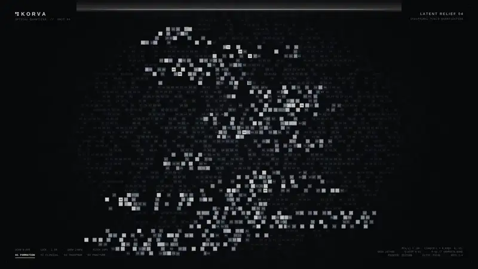

# KORVA — LATENT RELIEF 04

Original interactive procedural 3D sculptural bust rendered as a flat-tile pixel mosaic with live two-digit quantizer numerals, horizontal band displacement, traveling scanline resolution, edge-tile dispersion, and pointer disturbance.

**Live demo:** https://artem-kaseka.github.io/pixel-mosaic-portrait-scan/

[](https://github.com/artem-kaseka/pixel-mosaic-portrait-scan/releases/download/v1.0.0/pixel-mosaic-portrait-scan-1080p60.mp4)

**[Download / Watch full 1080p60 MP4 with stereo audio (28.9 MB)](https://github.com/artem-kaseka/pixel-mosaic-portrait-scan/releases/download/v1.0.0/pixel-mosaic-portrait-scan-1080p60.mp4)**

## Files

- `index.html` — Full-viewport standalone entry point (open directly in any modern browser).
- `mosaic.js` — Pure Canvas2D procedural 3D SDF sculptural bust raymarcher, deterministic simulation engine, numeral sprite atlas, and architectural typography overlay.
- `capture.mjs` — Deterministic zero-dependency headless Chrome (CDP) + `ffmpeg` 1080p60 capture pipeline with subtle original synthesized stereo scan ambience.
- `preview.webp` — Inline looping WebP preview generated from the deterministic 1080p60 capture.

## Live Controls

- **Keys `1`–`4`** — Switch presets:
  1. **FORMATION** — Cool graphite and bone on black; slow bright scanline locking noisy displaced bands into sculptural relief.
  2. **CLINICAL** — Tighter 14px tiles in surgical cyan, ice, and hospital white with dual-axis diagnostic scanlines.
  3. **PHOSPHOR** — Warm calibrated amber tube with faint residual P1 green, soft bloom, and lingering afterimage trails.
  4. **FRACTURE** — High-contrast monochrome with signal-vermilion fracture flares, violent band shear, and aggressive tile swarm restitching.
- **Pointer / Touch Move** — Locally unravels mosaic tiles, shears intersecting rows, scrambles numerals, and peels numbered tiles into space.
- **Click / Tap** (or **Space**) — Fires a radial shockwave and scan pulse.
- **Key `R`** — Re-triggers noise-to-bust resolution in the current preset.

## Deterministic Capture

```bash
node capture.mjs
```
